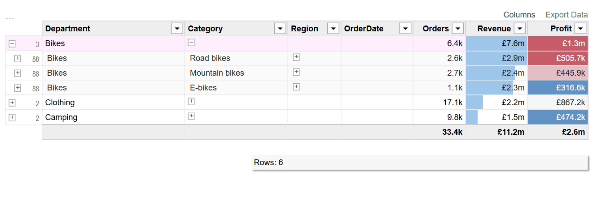
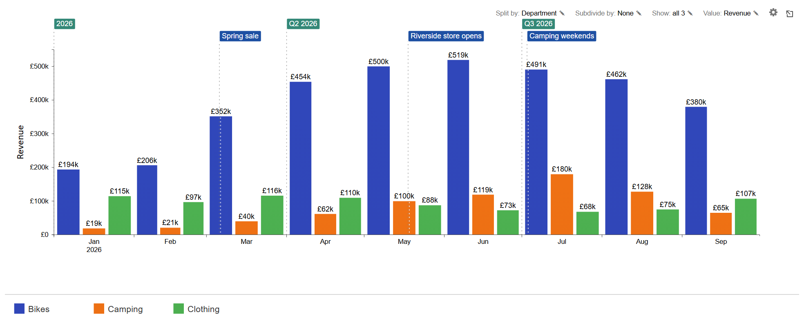
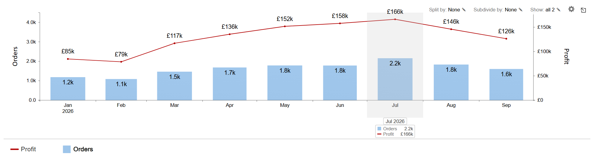
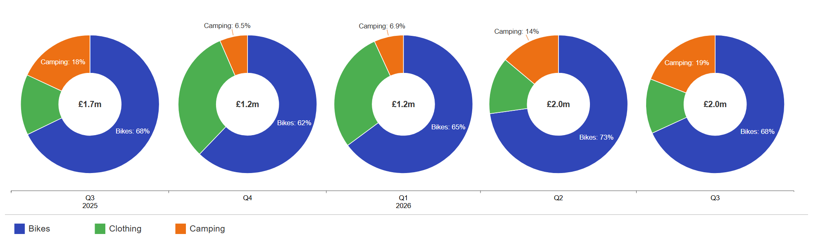
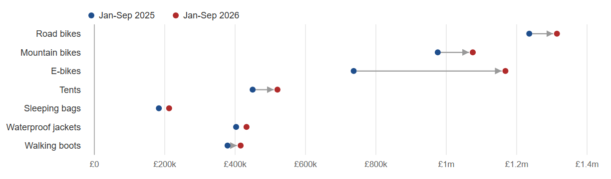
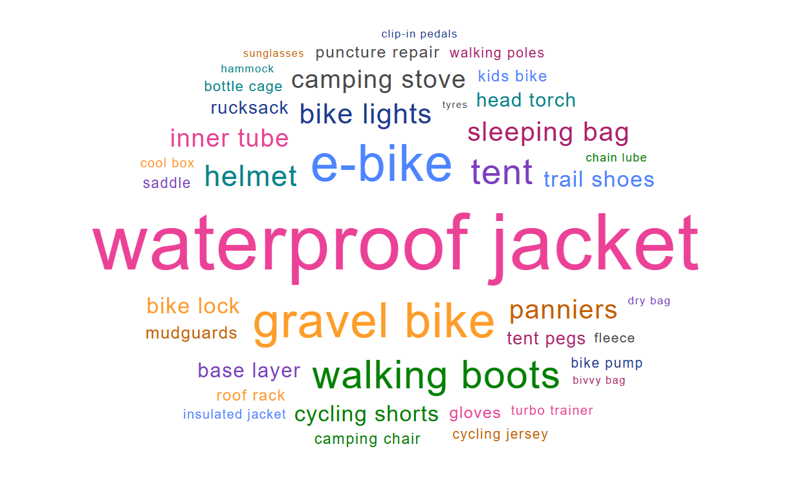
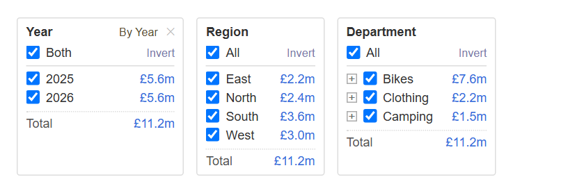

<br>

[](https://github.com/edwardsmale/Ren/releases/latest)
[](https://www.nuget.org/packages/Ren)

**A client-side reporting library: data grids, charts, filters and saved report settings, all in
the browser.**

Give Ren some tabular data and it builds an interactive report.  Users group, sort, filter, total,
chart and export the data themselves, and save the report the way they like it.  Your server only
has to serve the data.

```html
<link rel="stylesheet" href="/ren/ren.css">
<script src="/ren/ren.js"></script>

<ren-grid src="/data/sales" show-row-and-column-headings />
<ren-date-value-chart src="/data/sales" />
```

[Quick start](docs/quick-start.md) · [Security](docs/security.md) · [Examples](examples/) ·
[Changelog](CHANGELOG.md) · [Developing Ren](docs/development.md)

## What you can do with it

### Data grids

- **Group** on as many levels as you like, with expandable group rows and a totals row.
- **Aggregate** with more than 20 functions: sum, average, median, min, max, count, count
  distinct, first, last, most common, distinct values and more.
- **Sort and filter** on any column, with column filters that show what's applied.
- **Select cells** like a spreadsheet, with a stat bar totalling the selection, copy straight into
  Excel, or find text in the grid.
- **Resize and reorder columns**, page through rows, and save grid variations.
- **Download to Excel**, with correct number and date formatting.



### Charts

- **Date/value charts**: line, bar, stacked, pie and multi-charts, with trend lines,
  previous-year comparisons, date markers, crosshairs and hover values.  Select date ranges on
  them, or export them as images.
- **Change charts**, showing how each row moved between two periods.
- **Calendars**, **word clouds**, **stat bars** and **key-value grids**.
- **Cross-filtering**: click a series or a period to filter everything else on the page.

Ren draws its charts itself, so there's no charting library to add.


<br />

<br />

<br />

<br />


### Whole reports

- **Filter modules**, **filters bars** and **date selectors** that filter every visualisation
  sharing the data, and **settings groups** so a grid and a chart share one grouping and sort.

  

- **Report parameters** passed through to your data endpoints.
- **Saved settings**: named presets, per-user settings and a default for everyone, stored on your
  server or in the browser.
- **Layout containers**: tabs, expandable sections, tile groups, task boards and embedded reports.
- **Downloadable reports**: the data and the page bundled into a single HTML file.
- **Format functions**: small JavaScript snippets that calculate or format columns, with a library
  of ready-made ones and an editor in the page.
- **Theming** through `--ren-*` CSS custom properties, and number, currency and date formats.
- **Extensions** for your own data formats, settings stores and format functions.

### Data

Endpoints can return an array of objects, columns and rows, TSV, Ren's own tabular data set
collection (JSON with column formats and several tabs), or renpack, a compact binary format read
on a worker so big data sets don't hold up the page.  Ren tells them apart by itself.

## Installation

Ren ships as the `Ren` NuGet package.  Add it to a web project and, before each build, it copies
Ren's files into `wwwroot/ren/` (ASP.NET Core) or `Statics/ren/` (ASP.NET), so they're published
with the site.  Add that folder to `.gitignore`; to update Ren, update the package.

The package also has an optional .NET library that turns an `IDataReader`, `DataTable` or list of
objects into Ren's data formats (see [dotnet/README.md](dotnet/README.md)).

To try the examples, build Ren, run `dotnet run --project build/Ren.Build -- serve`, and open
http://localhost:8080/examples/.

### Download

Not using .NET?  Download the built files from the
[latest release](https://github.com/edwardsmale/Ren/releases/latest) and serve them yourself:

- [`ren.min.js`](https://github.com/edwardsmale/Ren/releases/latest/download/ren.min.js) or
  [`ren.esm.min.js`](https://github.com/edwardsmale/Ren/releases/latest/download/ren.esm.min.js)
  (an ES module)
- [`ren.min.css`](https://github.com/edwardsmale/Ren/releases/latest/download/ren.min.css)

The release also has unminified versions, source maps and the config schema.  Or build Ren
yourself (see [Developing Ren](docs/development.md)) and serve the files in `dist/`.

## Licence

MIT (see [LICENSE](LICENSE)).  `ren.js` includes Prism and code ported from d3, and Excel downloads
use write-excel-file, which a page includes itself if it wants them.  Their licences are in
[THIRD-PARTY-NOTICES.md](THIRD-PARTY-NOTICES.md).
